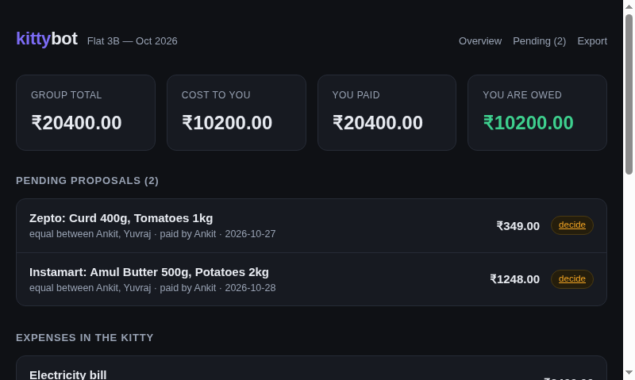
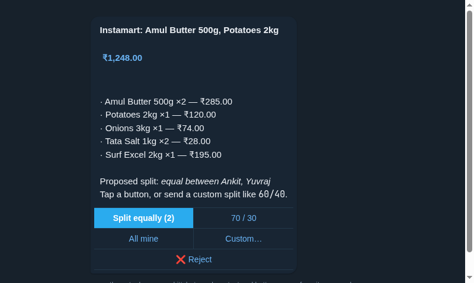
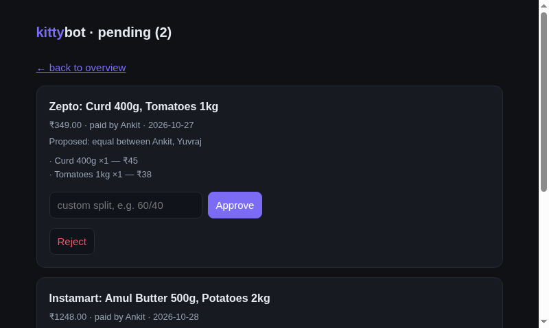

<p align="center">
  
</p>

<h1 align="center">kittybot</h1>

<p align="center">
  Split household expenses from Telegram.<br>
  Pull grocery orders from Instamart, Zepto, Blinkit and BigBasket,<br>
  approve every split, write it to <a href="https://kittysplit.com">Kittysplit</a>.
</p>

<p align="center">
  <a href="#install">Install</a> ·
  <a href="#setup">Setup</a> ·
  <a href="#commands">Commands</a> ·
  <a href="#how-it-works">How it works</a> ·
  <a href="#connect-the-grocery-apps">Connect the apps</a>
</p>

<p align="center">
  <a href="https://iankitkumar.in/tools/kittybot/">Read more on iankitkumar.in</a>
</p>

<p align="center">
  <a href="https://github.com/i-ankitkumar/kittybot/actions/workflows/ci.yml">
    
  </a>
  
  
</p>

---

```bash
git clone https://github.com/i-ankitkumar/kittybot && cd kittybot
docker compose up -d
```

No more opening five tabs to tell your flatmate what you paid for.

## Why an approval step

This is the whole point of the tool.

A ₹1,248 Instamart order might be entirely yours, entirely your flatmate's,
or split 70/30. **No rule can tell those apart.** So the bot asks, every
single time, and writes nothing to your kitty until you say yes.

<p align="center">
  
</p>

That is the actual message kittybot sends — the text and the buttons come
straight out of its own code. Tap a button, or send a custom split like
`60/40`, `800 400`, or `me`.

## Features

- **Add an expense in Telegram.** `/add 450 zepto groceries 60/40` lands in your kitty in seconds.
- **Import orders from grocery apps.** `/sync` pulls recent orders from Instamart, Zepto, Blinkit and BigBasket in read-only mode.
- **Every split goes through you.** Orders become proposals. You approve, adjust, or reject. Nothing is written without a human yes.
- **Any split you like.** Equal, weighted, percentage, fixed amounts, or entirely personal.
- **A dashboard.** Balances, the settlement plan, pending proposals, and spend history.
- **Read-only, by construction.** The marketplace adapters refuse to touch cart, checkout or payment endpoints, enforced by URL allowlists.

| Dashboard | Approvals |
|---|---|
|  |  |

## Install

```bash
git clone https://github.com/i-ankitkumar/kittybot
cd kittybot
uv venv && uv pip install -e ".[dev]"
```

or with plain pip:

```bash
python3 -m venv .venv && . .venv/bin/activate
pip install -e ".[dev]"
```

or with Docker:

```bash
docker compose up -d
```

## Setup

```bash
kittybot setup
```

The wizard asks for:

| Setting | What it is |
|---|---|
| **Telegram bot token** | From [@BotFather](https://t.me/BotFather). |
| **KittySplit URL** | The secret link from your kitty, e.g. `https://www.kittysplit.com/k/AbCdEf-12`. This is the only credential Kittysplit needs — no registration, no password. |
| **Your name in the kitty** | So the bot knows which participant you are. |
| **Marketplace logins** | Optional. See below. |

Then:

```bash
kittybot run
```

The bot talks to Telegram over long polling, so **no public URL or webhook tunnel is needed**. A dashboard is served at `http://localhost:8080`.

### Configuration

Settings live in `~/.config/kittybot/config.toml` (mode 600) and can be overridden with environment variables:

| Variable | Purpose |
|---|---|
| `KITTYBOT_KITTY_URL` | Your Kittysplit link |
| `KITTYBOT_MY_NAME` | Your name in the kitty |
| `KITTYBOT_BOT_TOKEN` | Telegram bot token |
| `KITTYBOT_DEFAULT_PAYER` | Who usually pays for grocery orders |
| `KITTYBOT_DEFAULT_SPLIT_MODE` | `equal` or `personal` |
| `KITTYBOT_SOURCES` | Comma-separated: `instamart,zepto,blinkit,bigbasket` |
| `KITTYBOT_ALLOWED_CHAT_IDS` | Restrict the bot to specific chat ids |
| `KITTYBOT_DASHBOARD_PORT` | Dashboard port (default 8080) |

## Commands

| Command | Does |
|---|---|
| `/add <amount> <description> [split]` | Record an expense. Split can be `50/50`, `70/30`, `60% 40%`, `800 400`, `me`, or omitted (you get asked). |
| `/sync [app]` | Pull recent orders and propose them. |
| `/pending` | List proposals waiting on you. |
| `/approve <id> [split]` | Approve a proposal, optionally with a custom split. |
| `/reject <id>` | Reject a proposal. |
| `/balance` | Who owes whom, and how to settle up. |
| `/export` | The kitty as a spreadsheet. |

The same things work from the terminal:

```bash
kittybot add 450 "Groceries" 50/50
kittybot pending
kittybot approve 3 70/30
kittybot balance
kittybot status
```

## How the split maths works

Kittysplit supports four split modes and kittybot maps straight onto them:

| Mode | Example | Notes |
|---|---|---|
| `equal` | `50/50` | Everyone involved splits evenly. |
| `percent` | `70/30`, `60% 40%` | Must total 100. |
| `weight` | `me 70 yuvraj 30` | Proportional shares. |
| `amount` | `800 400` | Fixed rupee amounts. Must total the expense. |

A personal expense (`/add 300 headphones personal`) records one participant as owing 100%. This is a first-class case, not an edge case: **half your grocery orders are yours alone**, and the bot treats that as normal rather than making you hunt for a "just me" option.

## Connect the grocery apps

All four are **read-only**. The tool never places, cancels or modifies an order.

| App | How it connects | Notes |
|---|---|---|
| Swiggy Instamart | Official Swiggy MCP server, OAuth | `kittybot connect instamart` |
| Zepto | Official Zepto MCP server, OAuth | `kittybot connect zepto` |
| Blinkit | Session import from your browser | `kittybot connect blinkit` |
| BigBasket | Session import from your browser | `kittybot connect bigbasket` |

Each adapter sits on a different rung of the integration ladder, and the
higher the rung the more durable it is:

| Rung | Adapter | How |
|---|---|---|
| 1. Official MCP server | Instamart, Zepto | OAuth 2.1 + PKCE, dynamic client registration, read-scoped tokens. Documented and allowlisted by the vendor. |
| 3. Session replay | Blinkit, BigBasket | One browser login, then the session is replayed headlessly. Undocumented, and it can break when the provider changes. |

**Instamart and Zepto** use each company's own MCP server with OAuth 2.1 + PKCE. The bot registers itself as a client, you approve in a browser, and it gets a read-scoped token. No browser automation, no scraping. Zepto's token is requested with `tools:read` only, so it physically cannot place an order.

**Blinkit and BigBasket** have no public API. The bot opens a real browser once, you log in yourself, and it saves your session to `~/.config/kittybot/` (mode 600) to replay. Your password never touches the bot — and BigBasket does not even have passwords, only OTPs.

> **Note on Blinkit and BigBasket:** these are undocumented internal endpoints. They can change without notice and may stop working. The adapters fail loudly rather than silently recording wrong amounts. Blinkit and BigBasket run bug-bounty programmes; use this for your own account, respectfully.

## Architecture

```
kittybot/
├── kittysplit.py     Kittysplit client: read, write, split modes, XLSX export
├── models.py         Split, Expense, ExpenseDraft, MarketOrder, approvals
├── splits.py         Parsing "50/50", "70/30", "800 400", "me" into splits
├── approvals.py      The approval gate: proposals in, approved expenses out
├── store.py          SQLite persistence and the audit trail
├── mcp.py            Minimal MCP client with OAuth 2.1 + PKCE
├── config.py         Config file and environment handling
├── cli.py            setup / run / connect / status / add / approve
├── bot/telegram.py   Telegram commands and the inline approval flow
├── dashboard/        FastAPI dashboard (server-rendered, no build step)
└── sources/          Read-only marketplace adapters
    ├── base.py         OrderSource protocol + normalisation
    ├── instamart.py    Swiggy Instamart (official MCP, OAuth)
    ├── zepto.py        Zepto (official MCP, OAuth)
    ├── blinkit.py      Blinkit (session import, Chrome TLS)
    └── bigbasket.py    BigBasket (session import, bill reconciliation)
```

### A note on the Kittysplit client

Kittysplit has no public REST API. The web app is a Phoenix server that renders HTML and accepts classic form posts, and the mobile apps talk to an internal `/api` surface that is version-gated behind `client_upgrade_required`.

So `kittysplit.py` speaks the actual protocol:

- the secret kitty link is the only credential,
- the "who are you" identity is a cookie (`kittysplit_viewing_parties`) holding base64 of `[{"key": …, "pid": …}]`,
- expenses are created by POSTing the `entries/new/expense` form,
- expenses are listed at `entries/` with machine-readable `data-*` attributes,
- the whole kitty exports as XLSX at `export/xlsx`.

Every endpoint and all four split modes were verified against a live kitty, and the test suite creates and deletes a throwaway kitty on each run.

## Safety properties

- **Nothing is written without approval.** `ApprovalEngine.approve()` is the only method in the codebase that creates an expense.
- **Read-only marketplace access, enforced.** Each adapter allowlists URL *prefixes*, not HTTP methods — Blinkit's cart and checkout endpoints are POSTs too, so a method-based rule would not be enough.
- **Bills reconcile or they are rejected.** BigBasket orders are checked line-by-line (`unit_price × quantity == line_total`), against the subtotal, and against the total. An order that does not add up is refused rather than recorded wrong.
- **Credentials stay local.** `~/.config/kittybot/`, mode 600, never in the repo.
- **Cancelled and refunded orders are skipped.** They are not spend.

## Development

```bash
pip install -e ".[dev]"

pytest tests/test_splits.py tests/test_wiring.py -v   # offline
KITTYBOT_LIVE=1 pytest tests/ -v                      # against a real kitty
ruff check .
```

The live tests create a throwaway kitty on Kittysplit, exercise every split mode and the whole approval flow, then delete it. No secrets required.

## Privacy

- Credentials live in `~/.config/kittybot/`, mode 600, never in the repo.
- Marketplace access is read-only.
- Phone numbers and addresses are never logged or sent to Telegram.
- Nothing is written to your kitty without an explicit approval.

## License

MIT
